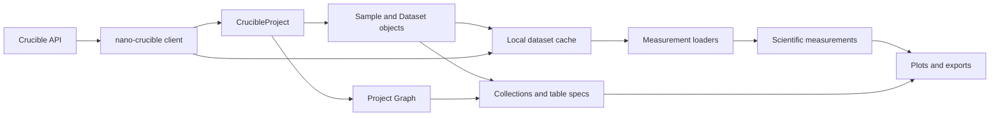

# Architecture

## Responsibility boundary

Crucible Labs turns Nano-normalized project records and downloaded files into analysis objects and scientific outputs. Nano remains responsible for authentication, configuration, HTTP behavior, pagination, API normalization, and file transfer. Labs remains responsible for project materialization, graph semantics, cache selection, measurement parsing, table construction, plotting, and export behavior.

The boundary is currently the Nano client accepted by `CrucibleProject` and passed to dataset workflows. This is an injectable client seam, not a second transport layer or a duplicated API schema.

## Project materialization

`CrucibleProject` obtains a client from Nano configuration unless a client is supplied. Construction reads the project record, lists all project datasets with metadata, lists all project samples with metadata, and fetches the project graph. Nano model classes validate the normalized project, dataset, and sample mappings before Labs wraps them as `CrucibleProject`, `Dataset`, and `Sample` analysis objects.

Datasets and samples are materialized before relationships. A resource map keyed by `unique_id` resolves graph endpoints. Same-kind edges preserve their source-to-target direction as parent and child genealogy. Cross-kind edges become bidirectional sample-dataset associations, regardless of which kind appears as the source.

The unified `Graph` adds every Labs resource as a NetworkX node and adds same-kind genealogy as directed edges. Cross-kind sample-dataset associations remain on the `Sample` and `Dataset` objects and are not added as NetworkX edges.

## Files, caches, and measurements

The default cache root comes from Nano configuration. Project measurement loading uses a `datasets` child directory, filters datasets through sample collections, and prefetches dataset files concurrently. `Dataset.prefetch()` delegates transfer to Nano's public `datasets.download()` operation with record output disabled. Labs decides whether existing local files satisfy the request and retains the downloaded paths for parsing.

`Dataset.load()` selects a loader using the dataset measurement type. It consumes prefetched paths when available, otherwise checks the local dataset directory and delegates a download to Nano when required. A loader receives the Labs `Dataset`, the local file paths, and loader-specific keyword arguments. It returns one measurement object, a list of measurement objects, or `None`.

Loaded measurements are attached to graph-linked samples. A single measurement linked to a single sample uses that association directly. Multi-sample results resolve samples by measurement identifiers or names.

## Loader registration

`Dataset` owns a process-local registry that maps Nano measurement type strings to loader callables. Importing `clabs.measurements` registers built-in UV-Vis, image, and RGA loaders. `register_loaders()` can restore the built-in mappings explicitly.

Each loader owns scientific file selection and parsing for its format. Nano owns obtaining the files, while Labs owns interpreting their contents and producing measurement objects.

## Collections, tables, and plots

`SampleCollection` and `DatasetCollection` provide indexed lookup and domain-specific filtering. A sample collection can derive the unique datasets associated with its samples and aggregate loaded measurements.

`RowSpec` selects sample or dataset row granularity. `FieldSpec` selects dataset metadata, sample metadata, or Python attributes. Table construction can walk sample ancestors and extract fields from their linked datasets, preserving the distinction between genealogy and sample-dataset association.

Graph plotting, thin-film grids, measurement plotting, and report generation consume materialized Labs objects. They do not own API transport, but they may create figures, files, or browser-visible output.
